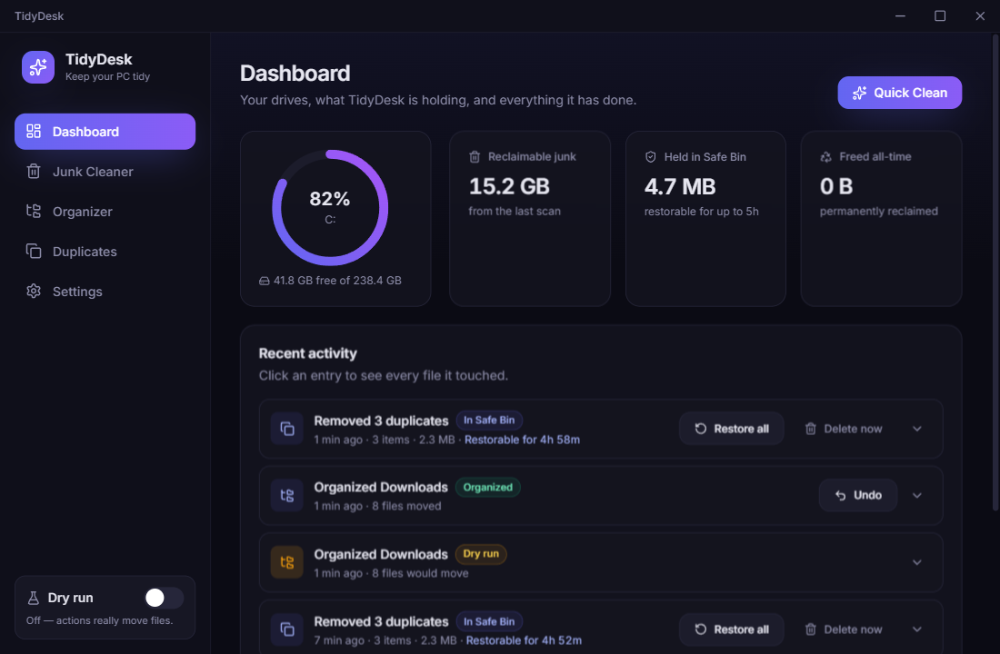
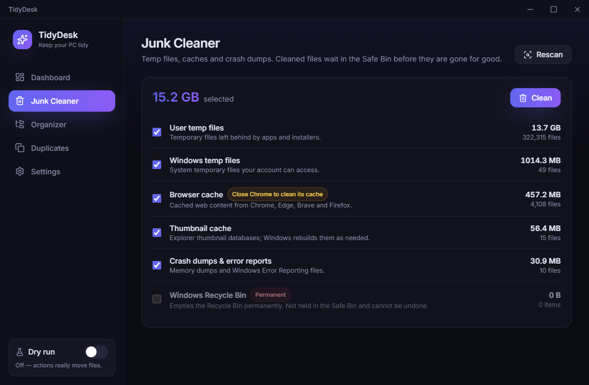
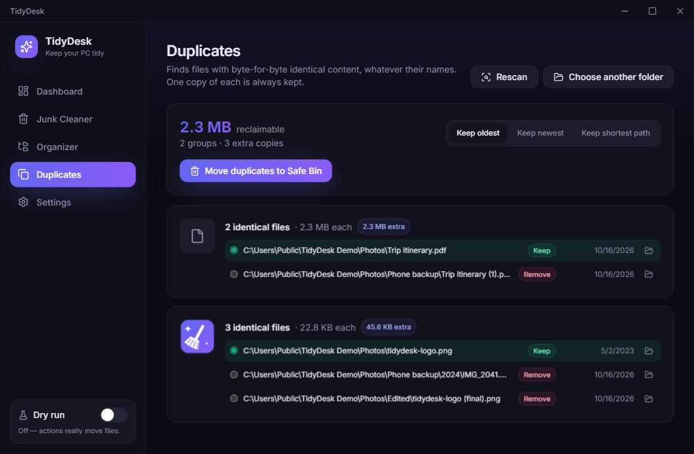
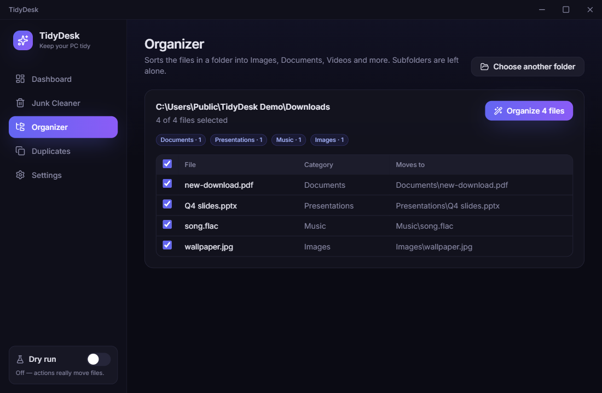

<div align="center">


# TidyDesk

**Clean junk, organize folders and remove duplicate files on Windows — safely.**

Everything TidyDesk removes waits in a restorable **Safe Bin** first, and every action is logged on the Dashboard with a one-click restore.

[Download for Windows](https://github.com/brian-dev-2026/TidyDesk/releases/latest) · [Report a bug](https://github.com/brian-dev-2026/TidyDesk/issues)

</div>



## Features

- **Junk Cleaner**: finds user and Windows temp files, browser caches (Chrome, Edge, Brave, Firefox), Explorer thumbnail caches, and crash dumps. Shows how much each one takes up, and lets you pick what to clean.
  - Files changed in the last hour are always skipped.
  - Caches of a browser that is open are skipped too.
- **Organizer**: sorts the loose files in a folder into `Images`, `Documents`, `Spreadsheets`, `Presentations`, `Videos`, `Music`, `Archives`, `Installers`, `Code` and `Other`.
  - You see a preview first and can untick any file.
  - Subfolders are never touched.
  - **Undo** puts every file back exactly where it was.
- **Duplicate Finder**: finds files with **byte-for-byte identical content** (SHA-256), whatever their names.
  - One copy in each group is always kept: the oldest, the newest or the shortest path, or one you pick yourself.
  - Image groups show thumbnails.
- **Dashboard**: shows disk usage, space held in the Safe Bin, space freed all-time, and a timeline of every action.
  - Open any entry to see each file it touched.
  - Restore single files or whole batches, undo organize runs, or delete permanently.
- **Dry run mode**: a single switch that simulates everything.
  - Scans and plans run for real, but nothing on disk is moved or deleted.
  - Results are logged on the Dashboard, so you can see exactly what *would* happen.
- **Modern UI**: dark and light themes (or follow Windows), keyboard-friendly, and a tray icon.

| Junk Cleaner | Duplicates | Organizer |
| --- | --- | --- |
|  |  |  |

## How deleting works (please read)

### The Safe Bin

When you clean junk or remove duplicates, TidyDesk **moves** the files into a hidden `.tidydesk-bin` folder on the same drive (for example `C:\.tidydesk-bin`). On the same drive this is an instant rename.

- For **5 hours** (configurable from 1 to 168 in Settings), you can restore any file to its original location from the Dashboard.
  - Missing folders are recreated.
  - If a new file now has the same name, the restored copy is saved as `name (restored).ext`.
- When the hold time ends, the batch is **deleted permanently** and the space is freed.
- **Delete now** frees the space immediately.
- The countdown keeps running while TidyDesk sits in the tray. If TidyDesk wasn't running when a batch expired, it is purged the next time TidyDesk starts.

### Windows Recycle Bin auto-sweep (on by default)

TidyDesk also **permanently deletes anything that has been in the Windows Recycle Bin for longer than the hold time**. That includes files you deleted yourself in Explorer.

- You get a notice the first time you run TidyDesk.
- Turn it off any time in **Settings → Windows Recycle Bin auto-sweep**.

### Dry run

Turn on **Dry run** in the sidebar to test everything safely.

- While it is on, TidyDesk never moves, renames or deletes a file.
- The Safe Bin timer and the Recycle Bin sweep are paused.

## Install

1. Download `TidyDesk-Setup-x.y.z.exe` from the [latest release](https://github.com/brian-dev-2026/TidyDesk/releases/latest).
2. Run it and choose where to install. Shortcuts are added to the Start Menu and the desktop.

> **Windows SmartScreen** may say *"Windows protected your PC — Unknown publisher"* because the installer isn't code-signed. Click **More info → Run anyway**.

**Uninstalling**: use *Settings → Apps* in Windows.

- The uninstaller doesn't touch Safe Bin folders, so anything still held stays recoverable.
- If you want them gone, delete any leftover `X:\.tidydesk-bin` folders by hand. They are hidden, so turn on *Show hidden items* in Explorer.
- Your history and settings live in `%APPDATA%\TidyDesk`.

## Build from source

Requirements: Windows 10/11 and Node.js 20 or newer.

```bash
git clone https://github.com/brian-dev-2026/TidyDesk.git
cd TidyDesk
npm ci
npm run dev        # run the app with hot reload
npm test           # unit + integration tests (Vitest)
npm run typecheck
npm run dist       # build dist/TidyDesk-Setup-<version>.exe
```

Set `TIDYDESK_DATA_DIR` to run against a throwaway history and settings folder while developing.

Behind a corporate proxy, the Electron download needs `ELECTRON_GET_USE_PROXY=1` and `GLOBAL_AGENT_HTTPS_PROXY=<your proxy>`.

### Project layout

| Path | What it is |
| --- | --- |
| `src/main/` | Electron main process. All file-system logic lives here in small, Electron-free modules: `safebin`, `organizer`, `duplicates`, `junk`, `recyclebin`, `history`, `scheduler`, `guards` and more. |
| `src/preload/` | The typed `window.tidy` bridge (context isolation on, sandboxed renderer). |
| `src/renderer/` | React + Tailwind UI. |
| `src/shared/` | Types shared across processes. |
| `tests/` | Vitest suites that run against real temporary folders. |

## Releasing

Push a version tag and GitHub Actions builds the installer and attaches it to a GitHub Release:

```bash
npm version 0.2.0
git push --follow-tags
```

## License

[MIT](LICENSE)
