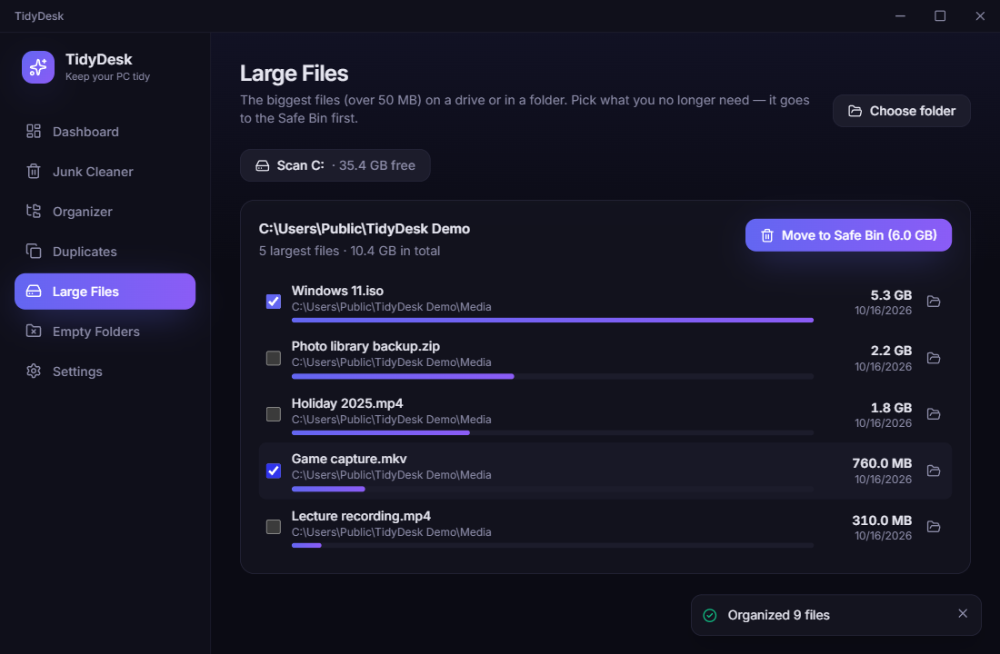
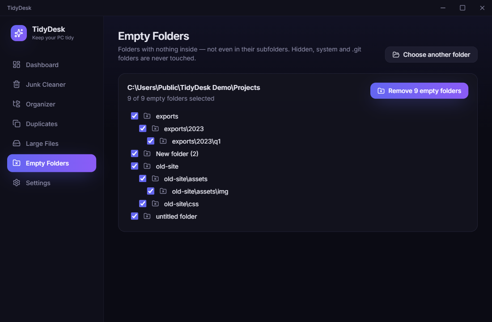

<div align="center">


# TidyDesk

**Clean junk, organize folders and remove duplicate files on Windows — safely.**

Everything TidyDesk removes waits in a restorable **Safe Bin** first, and every action is logged on the Dashboard with a one-click restore.

[Download for Windows](https://github.com/brian-dev-2026/TidyDesk/releases/latest) · [Report a bug](https://github.com/brian-dev-2026/TidyDesk/issues)

</div>


## Features

- **Junk Cleaner**: finds user and Windows temp files, browser caches (Chrome, Edge, Brave, Firefox), Explorer thumbnail caches, and crash dumps. Shows how much each one takes up, and lets you pick what to clean.
  - Files changed in the last hour are always skipped.
  - Caches of a browser that is open are skipped too.
- **Organizer**: one click on **Organize Desktop** sorts the loose files into `Images`, `Documents`, `Spreadsheets`, `Presentations`, `Videos`, `Music`, `Archives`, `Installers`, `Code` and `Other` (or into year / month folders).
  - Add more folders, or drop any folder on the page to organize it once (you are asked first).
  - Shortcuts and subfolders are never touched.
  - **Undo** puts every file back exactly where it was.
- **Duplicates**: one click on **Remove duplicates** checks Desktop, Documents, Downloads, Pictures, Music and Videos for files with **byte-for-byte identical content** (SHA-256), whatever their names.
  - The oldest copy is kept; the others go to the Safe Bin, so you can restore them.
  - Only photos, documents, music, videos and archives are compared. Program, game and project folders (such as `AppData`, `node_modules` or anything with a `.git` folder) are skipped.
  - Every copy is checked again just before it moves; anything that changed during the scan is left alone.
- **Large Files**: lists the biggest files (over 50 MB) on a drive or in a folder, so you can send the ones you no longer need to the Safe Bin.
- **Empty Folders**: finds folders with nothing inside, even in their subfolders, and removes them. They can be recreated with one click.
- **Scheduled auto-clean**: cleans the junk categories you choose daily or weekly, in the background.
- **Exclusions**: folders TidyDesk must never touch, in every feature.
- **Drag & drop**: drop a folder on the Organizer, Duplicates, Large Files or Empty Folders page.
- **Dashboard**: shows disk usage, space held in the Safe Bin, space freed all-time, and a timeline of every action.
  - Open any entry to see each file it touched.
  - Restore single files or whole batches, undo organize runs, or delete permanently.
- **Activity export and logs**: export the full history as CSV, or open the error log from Settings.
- **Automatic updates**: new versions download in the background and install when you restart.
- **Modern UI**: dark and light themes (or follow Windows), keyboard-friendly, and a tray icon.

| Junk Cleaner | Duplicates | Organizer |
| --- | --- | --- |
|  |  |  |

| Large Files | Empty Folders |
| --- | --- |
|  |  |

## How deleting works (please read)

### The Safe Bin

When you clean junk or remove duplicates, TidyDesk **moves** the files into a hidden `.tidydesk-bin` folder on the same drive (for example `C:\.tidydesk-bin`). On the same drive this is an instant rename.

- For **5 hours** (configurable from 1 to 168 in Settings), you can restore any file to its original location from the Dashboard.
  - Missing folders are recreated.
  - If a new file now has the same name, the restored copy is saved as `name (restored).ext`.
- When the hold time ends, the batch is **deleted permanently** and the space is freed.
- **Delete now** frees the space immediately.
- The countdown keeps running while TidyDesk sits in the tray. If TidyDesk wasn't running when a batch expired, it is purged the next time TidyDesk starts.

### Windows Recycle Bin auto-sweep (on by default)

TidyDesk also **permanently deletes anything that has been in the Windows Recycle Bin for longer than the hold time**. That includes files you deleted yourself in Explorer.

- You get a notice the first time you run TidyDesk.
- Turn it off any time in **Settings → Windows Recycle Bin auto-sweep**.

## Install

1. Download `TidyDesk-Setup-x.y.z.exe` from the [latest release](https://github.com/brian-dev-2026/TidyDesk/releases/latest).
2. Run it and choose where to install. Shortcuts are added to the Start Menu and the desktop.

> **Windows SmartScreen** may say *"Windows protected your PC — Unknown publisher"* because the installer isn't code-signed. Click **More info → Run anyway**.

**Uninstalling**: use *Settings → Apps* in Windows.

- The uninstaller doesn't touch Safe Bin folders, so anything still held stays recoverable.
- If you want them gone, delete any leftover `X:\.tidydesk-bin` folders by hand. They are hidden, so turn on *Show hidden items* in Explorer.
- Your history and settings live in `%APPDATA%\TidyDesk`.

## Updating

TidyDesk checks GitHub Releases at startup and every 6 hours. A new version downloads in the background (turn off **Settings → Automatically download updates** to only be notified) and installs the next time you restart TidyDesk. Your settings, history and Safe Bin are kept.

## Build from source

Requirements: Windows 10/11 and Node.js 20 or newer.

```bash
git clone https://github.com/brian-dev-2026/TidyDesk.git
cd TidyDesk
npm ci
npm run dev        # run the app with hot reload
npm test           # unit + integration tests (Vitest)
npm run typecheck
npm run dist       # build dist/TidyDesk-Setup-<version>.exe
```

Set `TIDYDESK_DATA_DIR` to run against a throwaway history and settings folder while developing.

`npm run dev` also shows a **Dry run** switch that simulates every action without touching files. It is a development tool and is not part of the installed app.

Behind a corporate proxy, the Electron download needs `ELECTRON_GET_USE_PROXY=1` and `GLOBAL_AGENT_HTTPS_PROXY=<your proxy>`.

### Project layout

| Path | What it is |
| --- | --- |
| `src/main/` | Electron main process. All file-system logic lives here in small, Electron-free modules: `safebin`, `organizer`, `duplicates`, `junk`, `recyclebin`, `history`, `scheduler`, `guards` and more. |
| `src/preload/` | The typed `window.tidy` bridge (context isolation on, sandboxed renderer). |
| `src/renderer/` | React + Tailwind UI. |
| `src/shared/` | Types shared across processes. |
| `tests/` | Vitest suites that run against real temporary folders. |

## Versioning

TidyDesk follows [semantic versioning](https://semver.org), starting at **1.0.0**:

- **Patch** (`1.0.1`): bug fixes only.
- **Minor** (`1.1.0`): new features that don't change how existing ones behave.
- **Major** (`2.0.0`): changes that break existing behaviour or settings.

## Releasing

Push a version tag and GitHub Actions builds the installer and attaches it to a GitHub Release, where the auto-updater finds it:

```bash
npm version minor   # or patch / major
git push --follow-tags
```

## License

[MIT](LICENSE)
